<div align="center">

# Time Series Analysis & Forecasting

**Phân tích Chuỗi Thời gian và Dự báo** · Trường Đại học Giao thông Vận tải TP.HCM (UTH)

<br>


<br>

`EDA` → `ARIMA / SARIMA` → `XGBoost` → `VAR` → `LSTM`

</div>

---

Repo tổng hợp các bài thực hành trong môn học, đi từ khám phá dữ liệu, mô hình thống kê cổ điển, Machine Learning cho đến dự báo đa biến và Deep Learning. Mỗi bài đều có code, biểu đồ và nhận xét.

## Mục lục

1. [Kiến thức đạt được](#kiến-thức-đạt-được)
2. [Cấu trúc thư mục](#cấu-trúc-thư-mục)
3. [Dữ liệu sử dụng](#dữ-liệu-sử-dụng)
4. [Chương 2 – Làm việc với dữ liệu chuỗi thời gian](#chương-2--làm-việc-với-dữ-liệu-chuỗi-thời-gian)
5. [Chương 3.1 – Mô hình thống kê ARIMA / SARIMA](#chương-31--mô-hình-thống-kê-arima--sarima)
6. [Chương 3.2 – Mô hình Machine Learning](#chương-32--mô-hình-machine-learning)
7. [Chương 4–5 – Dự báo đa biến: VAR, XGBoost, LSTM](#chương-45--dự-báo-đa-biến-var-xgboost-lstm)
8. [Cài đặt & chạy](#cài-đặt--chạy)

---

## Kiến thức đạt được

| Chủ đề | Nội dung cụ thể |
|---|---|
| **Khám phá dữ liệu (EDA)** | Line plot, rolling mean/std, seasonal plot theo tháng, heatmap month × year |
| **Tự tương quan** | ACF, PACF, ngưỡng tin cậy 95% `±1.96/√n`, phân biệt chuỗi có cấu trúc với **white noise** |
| **Phân rã chuỗi** | STL decomposition: Trend – Seasonal – Residual |
| **Chất lượng dữ liệu** | Xử lý missing (Forward-fill vs Interpolation), phát hiện outlier bằng Z-score |
| **Tính dừng** | Kiểm định **ADF** (H₀: có nghiệm đơn vị), sai phân thường `d` và sai phân mùa vụ `D` |
| **Chọn bậc mô hình** | Đọc ACF/PACF để chọn `(p, q)` và `(P, Q)`, nhận diện **over-differencing** |
| **ARIMA / SARIMA** | Fit mô hình, so sánh AIC/BIC, chẩn đoán phần dư (residual ≈ white noise) |
| **Supervised learning cho chuỗi thời gian** | Tạo lag features, rolling features, chia train/test theo thời gian (không shuffle) |
| **Tránh data leakage** | Rolling feature phải `shift(1)` trước khi tính để không chứa giá trị cần dự báo |
| **Machine Learning** | XGBoost, Random Forest, Linear Regression, feature importance |
| **Đánh giá & tối ưu** | MAE, RMSE, MAPE · Multi-step forecasting (t+1…t+3) · Tune tham số bằng `TimeSeriesSplit` |
| **Dự báo đa biến** | Dùng biến ngoại sinh (nhiệt độ, độ ẩm, gió) · Mô hình **VAR**, chọn bậc trễ bằng AIC |
| **Deep Learning** | **LSTM** xếp chồng, dữ liệu 3D `(samples, timesteps, features)`, sliding window 24h, EarlyStopping |
| **Quy trình đánh giá chuẩn** | Chia Train/Val/Test 70/15/15 · `StandardScaler` chỉ fit trên train · **Walk-forward validation** |

---

## Cấu trúc thư mục

```
Mis_TimeSeries_Lesson/
├── Data/                              # Dataset (xem mục Dữ liệu)
├── WokingWithDataset(C2)/             # Chương 2: EDA, ACF/PACF, decomposition, data quality
│   ├── bai1_acf_pacf.py
│   ├── bai2_whitenoise.py
│   ├── bai3_decomposition.py
│   ├── bai4_data_quality.py
│   ├── bai5_visualize.py
│   └── bai6_report.py
├── Statistical_model(C3_P1)/          # Chương 3 – Phần 1: mô hình thống kê
│   ├── ARIMA/ARIMA_MODEL.py           #   Monthly Retail Sales
│   ├── SARIMA/SARIMA_MODEL.py         #   AirPassengers
│   └── Plot/                          #   Biểu đồ kết quả
├── Machine_Learning_model(C3_P2)/     # Chương 3 – Phần 2: mô hình ML
│   ├── MachineLearning.py             #   PJM Hourly Energy Consumption
│   └── plot/
├── Deep_Learning_model(C4_C5)/        # Chương 4–5: dự báo đa biến (Load + Weather)
│   ├── utils.py                       #   Hàm dùng chung: load data, logging, split, scale
│   ├── data_description.py            #   EDA dữ liệu đa biến
│   ├── var_model.py                   #   VAR (baseline thống kê)
│   ├── xgb_model.py                   #   XGBoost (Machine Learning)
│   ├── lstm_model.py                  #   LSTM (Deep Learning)
│   ├── logs/                          #   Log nhận xét của từng mô hình
│   └── plots/                         #   Biểu đồ: description / var / xgb / lstm
└── khác(TaiLieuThamKhao)/             # Tài liệu & code tham khảo (z-table, ADF, ACF/PACF...)
```

---

## Dữ liệu sử dụng

| Dataset | Tần suất | Số quan sát | Dùng ở |
|---|---|---|---|
| `daily-min-temperatures.csv` – Nhiệt độ thấp nhất hằng ngày (Melbourne, 1981–1990) | Ngày | 3.650 | C2 – Bài 1, 4, 6 |
| `AirPassengers.csv` – Số hành khách hàng không (1949–1960) | Tháng | 144 | C2 – Bài 2, 3, 5 · C3 – SARIMA |
| `Monthly_Retail_Sales.csv` – Doanh số bán lẻ (1991–2008) | Tháng | 204 | C3 – ARIMA |
| `ML_DATA/PJMW_hourly.csv` – [PJM Hourly Energy Consumption](https://www.kaggle.com/datasets/robikscube/hourly-energy-consumption) | Giờ | ~143.000 | C3 – Machine Learning |
| `data_lab4/weather and load dataset.csv` – Điện năng tiêu thụ + thời tiết (11/2021–11/2022) | Giờ | 8.779 | C4–C5 – VAR, XGBoost, LSTM |

> **Lưu ý:** Thư mục `Data/ML_DATA/` (~45 MB) không được đưa lên GitHub. Tải dataset từ Kaggle ở link trên và đặt vào `Data/ML_DATA/`.

---

## Chương 2 – Làm việc với dữ liệu chuỗi thời gian

| Bài | Nội dung | Kết luận chính |
|---|---|---|
| **Bài 1** – ACF/PACF | Tính ACF, PACF đến 40 lags cho chuỗi nhiệt độ | ACF giảm dần, PACF có spike mạnh ở lag 1 → chuỗi có tự tương quan rõ |
| **Bài 2** – White Noise | Sinh 1.000 điểm nhiễu trắng, so sánh ACF với AirPassengers | White noise: các lag nằm trong ngưỡng 95%; AirPassengers: ACF lớn, giảm chậm → có trend & mùa vụ |
| **Bài 3** – Decomposition | STL với `period=12` trên AirPassengers | Trend tăng đều, Seasonal lặp lại hằng năm, Residual dao động quanh 0 |
| **Bài 4** – Data Quality | Giả lập 1.000 giá trị NaN, xử lý bằng ffill & interpolate; Z-score > 3 là outlier | Interpolation cho chuỗi mượt và liên tục hơn ffill |
| **Bài 5** – Visualization | Line chart, rolling mean/std (12), seasonal plot, heatmap | Lượng khách tăng theo năm, cao điểm vào tháng 7–8 |
| **Bài 6** – Report | Tổng hợp kết quả các bài trên vào file log | Chuỗi không phải white noise → phù hợp để xây dựng mô hình dự báo |

---

## Chương 3.1 – Mô hình thống kê ARIMA / SARIMA

### Quy trình Box–Jenkins đã thực hiện

```
EDA ─▶ Kiểm định ADF ─▶ Sai phân (d, D) ─▶ ACF/PACF chọn (p,q)(P,Q) ─▶ Fit mô hình ─▶ Chẩn đoán phần dư ─▶ Forecast & đánh giá
```

### Monthly Retail Sales – `ARIMA_MODEL.py`

- Chuỗi gốc có **trend tăng + mùa vụ 12 tháng + phương sai tăng dần** → ADF xác nhận **không dừng** (p-value ≈ 1.00).
- Sai phân bậc 1 vẫn chưa dừng (p = 0.117); sai phân bậc 2 vượt qua ADF (p ≈ 3.5e-18) nhưng ACF/PACF bị kéo dài bất thường → dấu hiệu **over-differencing**. Vì vậy chọn `d = 1` và xử lý phần không dừng còn lại bằng **sai phân mùa vụ `D = 1`**.
- So sánh **ARIMA(1,1,1)** và **SARIMA(1,1,1)(1,1,1,12)** trên tập test 20%:

<table>
<tr>
<td>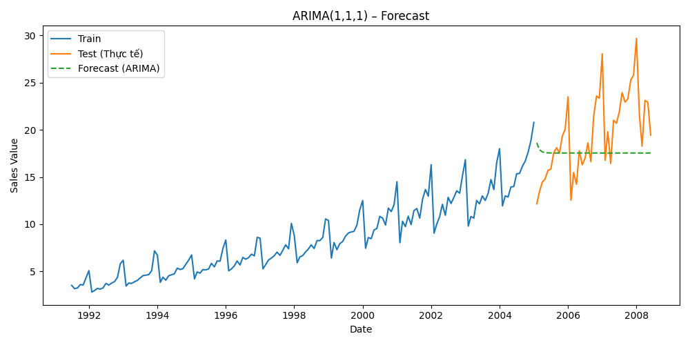</td>
<td>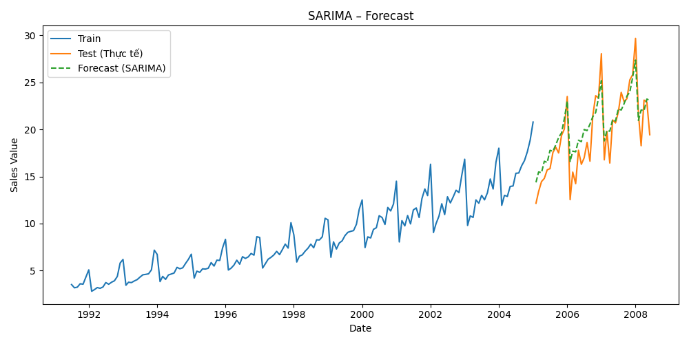</td>
</tr>
<tr>
<td align="center">ARIMA(1,1,1) – chỉ bắt được xu hướng</td>
<td align="center">SARIMA(1,1,1)(1,1,1,12) – bắt được cả mùa vụ</td>
</tr>
</table>

| Mô hình | AIC | BIC | MAE | RMSE | MAPE |
|---|---|---|---|---|---|
| ARIMA(1,1,1) | 582.47 | 591.73 | 3.667 | 4.624 | 18.04% |
| **SARIMA(1,1,1)(1,1,1,12)** | **231.11** | **245.67** | **1.502** | **1.945** | **8.69%** |

→ SARIMA giảm sai số **~58%** (RMSE 4.62 → 1.95), MAPE giảm từ 18% xuống dưới 9%.

### AirPassengers – `SARIMA_MODEL.py`

- Chuỗi gốc không dừng (ADF p = 0.992). Sai phân thường `d=1` kết hợp sai phân mùa vụ `D=1, s=12` → chuỗi dừng (p < 0.001).
- ACF/PACF có spike ở lag 1 và lag 12 → chọn **SARIMA(1,1,1)(1,1,1,12)**.

<table>
<tr>
<td>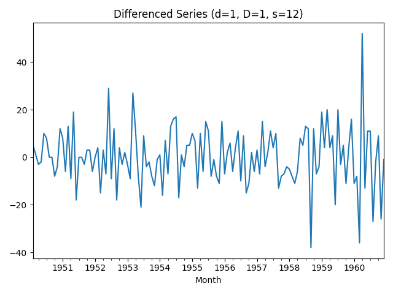</td>
<td>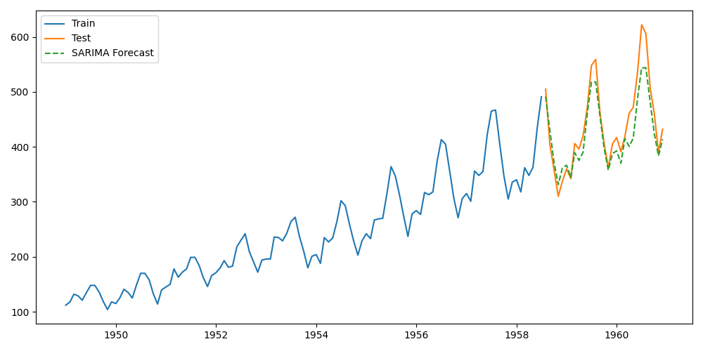</td>
</tr>
<tr>
<td align="center">Chuỗi sau sai phân (d=1, D=1)</td>
<td align="center">Dự báo SARIMA trên tập test</td>
</tr>
</table>

| Mô hình | MAE | RMSE |
|---|---|---|
| ARIMA(1,1,1) | 85.25 | 97.50 |
| **SARIMA(1,1,1)(1,1,1,12)** | **25.27** | **31.79** |

**Kết luận:** Với dữ liệu có mùa vụ rõ, SARIMA cho sai số thấp hơn ARIMA khoảng **3 lần** vì mô hình hóa được cả xu hướng lẫn chu kỳ mùa vụ.

---

## Chương 3.2 – Mô hình Machine Learning

**Dataset:** PJM West – điện tiêu thụ theo giờ (MW). Bài toán dự báo được chuyển thành **hồi quy có giám sát** bằng cách tạo đặc trưng từ quá khứ.

### Pipeline

1. Tạo **lag features** `lag_1 … lag_p` (mặc định `p = 3`)
2. Bổ sung **rolling mean / rolling std** (window = 3, tính trên `y.shift(1)` để tránh rò rỉ dữ liệu)
3. Chia train/test **80/20 theo thứ tự thời gian**
4. Huấn luyện **XGBoost**, so sánh với **Linear Regression** và **Random Forest**
5. **Multi-step forecasting** (dự báo t+1, t+2, t+3 bằng chiến lược direct)
6. **Tune** `max_depth`, `learning_rate` bằng `TimeSeriesSplit(n_splits=5)`

<table>
<tr>
<td>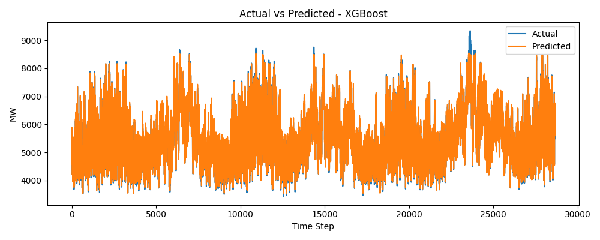</td>
<td>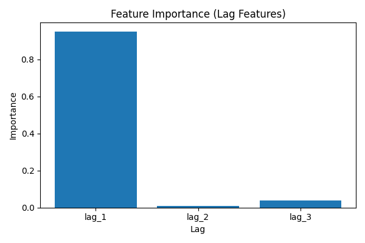</td>
</tr>
<tr>
<td align="center">Thực tế vs Dự báo (XGBoost)</td>
<td align="center">Feature importance: <code>lag_1</code> chiếm ~95%</td>
</tr>
<tr>
<td>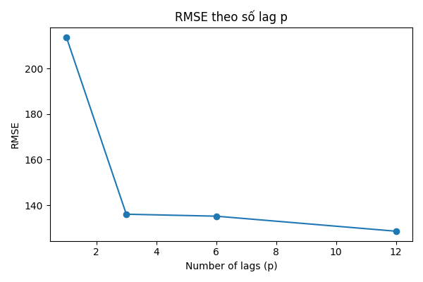</td>
<td>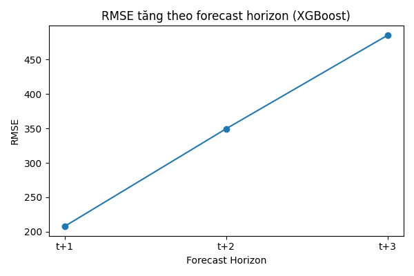</td>
</tr>
<tr>
<td align="center">RMSE theo số lag p</td>
<td align="center">RMSE theo forecast horizon</td>
</tr>
</table>

### Kết quả

**XGBoost với 3 lag** (train 114.562 giờ, test 28.641 giờ):

| MAE | RMSE | MAPE |
|---|---|---|
| 102.18 MW | 135.58 MW | **1.84%** |

**So sánh mô hình** (lag + rolling features, fold cuối của `TimeSeriesSplit`, XGBoost dùng tham số tốt nhất `max_depth=3, lr=0.1`):

| Mô hình | RMSE (MW) | MAPE |
|---|---|---|
| **Linear Regression** | **118.23** | **1.60%** |
| XGBoost (tuned) | 136.77 | 1.84% |
| Random Forest | 170.75 | – |

| Số lag `p` | 1 | 3 | 6 | 12 |
|---|---|---|---|---|
| RMSE (MW) | 213.73 | 136.07 | 135.20 | 128.61 |

| Horizon | 1 giờ | 2 giờ | 3 giờ |
|---|---|---|---|
| RMSE (MW) | 135.48 | 278.96 | 421.32 |
| MAPE | 1.85% | 3.87% | 6.00% |

### Nhận xét chính

- **`lag_1` là đặc trưng quan trọng nhất** (importance 0.95) – điện tiêu thụ giờ trước gần như quyết định giờ sau.
- **Tăng số lag**: RMSE giảm mạnh từ `p=1` lên `p=3`, sau đó chỉ cải thiện nhẹ đến `p=12` → lợi ích giảm dần khi thêm lag.
- **Dự báo càng xa sai số càng lớn**: RMSE tăng gần gấp 3 lần khi dự báo xa từ 1 giờ lên 3 giờ.
- **Linear Regression thắng XGBoost**: khi feature chỉ là lag và rolling của vài giờ gần nhất, quan hệ gần như tuyến tính nên mô hình tuyến tính đã đủ tốt. XGBoost vẫn vượt Random Forest.
- **Bài học về data leakage**: phiên bản đầu tính rolling mean có chứa `y_t`, khiến Linear Regression đạt RMSE = 0 (vì `y_t = 3·rolling_mean − lag_1 − lag_2`). Sau khi sửa bằng `shift(1)`, kết quả mới phản ánh đúng năng lực mô hình.
- **Hướng cải thiện**: thêm feature lịch (giờ trong ngày, thứ trong tuần) và lag mùa vụ (24h, 168h) để XGBoost khai thác quan hệ phi tuyến.

---

## Chương 4–5 – Dự báo đa biến: VAR, XGBoost, LSTM

**Bài toán:** dự báo điện năng tiêu thụ `load_MW` của giờ tiếp theo, dựa trên lịch sử tải và các biến thời tiết (`temperature`, `humidity`, `wind_speed`).
Ba hướng tiếp cận được so sánh trên **cùng một quy trình**:

```
Load data ─▶ Train/Val/Test 70/15/15 (theo thời gian) ─▶ StandardScaler fit trên train (XGBoost, LSTM) ─▶ Huấn luyện ─▶ Walk-forward 1.317 bước ─▶ Đánh giá (MW)
```

> **Walk-forward validation:** dự báo t+1 → đưa **giá trị thật** của t+1 vào lịch sử → dự báo t+2 → … Cách này mô phỏng đúng việc dự báo ngoài thực tế, nơi mỗi giờ ta lại có thêm một quan sát mới.

### 1. Khám phá dữ liệu – `data_description.py`

- 8.779 quan sát theo giờ, **không có missing và duplicate**. Theo IQR có 171 outlier ở `load_MW` (gồm các giờ load ≈ 0 MW), 210 ở `temperature`, 122 ở `wind_speed`.
- ACF có đỉnh lặp lại tại lag **24, 48, 72…** (chu kỳ ngày) và lag **168** (chu kỳ tuần). PACF có spike mạnh ở lag 1.
- **Nhiệt độ** là biến thời tiết tương quan mạnh nhất với load; độ ẩm và tốc độ gió ảnh hưởng yếu.

<table>
<tr>
<td>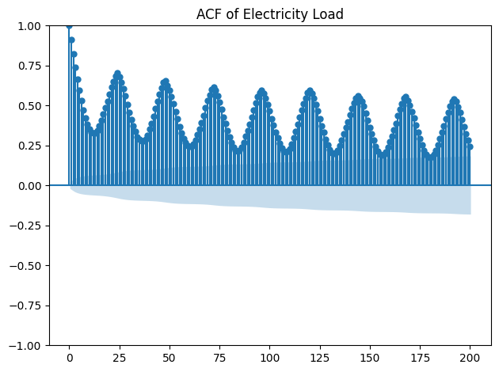</td>
<td>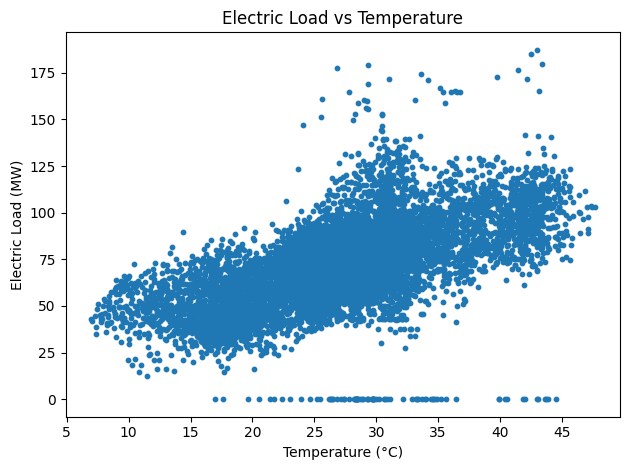</td>
</tr>
<tr>
<td align="center">ACF: chu kỳ 24h và 168h</td>
<td align="center">Load tăng theo nhiệt độ</td>
</tr>
<tr>
<td>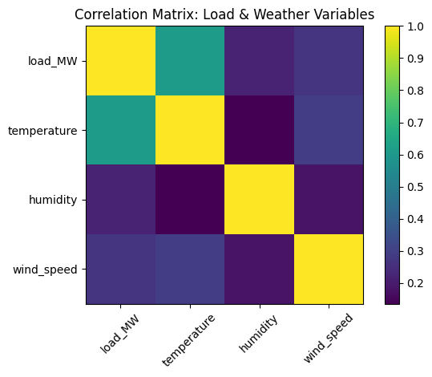</td>
<td>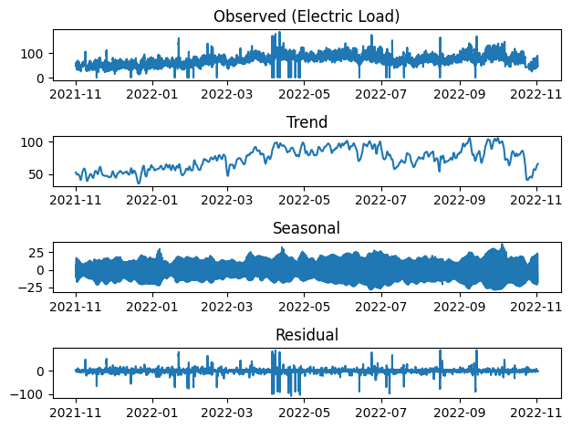</td>
</tr>
<tr>
<td align="center">Ma trận tương quan</td>
<td align="center">STL decomposition (period = 24)</td>
</tr>
</table>

### 2. Ba mô hình

| | **VAR** – `var_model.py` | **XGBoost** – `xgb_model.py` | **LSTM** – `lstm_model.py` |
|---|---|---|---|
| Nhóm | Thống kê (baseline) | Machine Learning | Deep Learning |
| Đầu vào | 4 biến, sai phân bậc 1 | 99 feature: lag 1–24 của 4 biến + rolling mean 6h, rolling std 24h, load trend | Cửa sổ 24 giờ × 4 biến |
| Điểm chính | ADF trên train: `temperature`, `humidity` không dừng → `d = 1`. AIC chọn bậc trễ **p = 6** | Tối đa 500 cây, `max_depth=6`, early stopping trên validation → 113 cây | `LSTM(64) → LSTM(32) → Dense(1)`, 30.113 tham số, loss MSE, Adam, EarlyStopping (patience 5) |

### 3. Kết quả trên tập test (1.317 giờ, 08/09 → 01/11/2022)

| Mô hình | RMSE (MW) | MAE (MW) | MAPE* |
|---|---|---|---|
| VAR(6) | 7.46 | 4.98 | 6.28% |
| XGBoost | 7.37 | **4.54** | **5.46%** |
| **LSTM** | **7.30** | 4.82 | 5.99% |

<sub>* MAPE tính trên các giờ có load ≠ 0 MW.</sub>

<table>
<tr>
<td>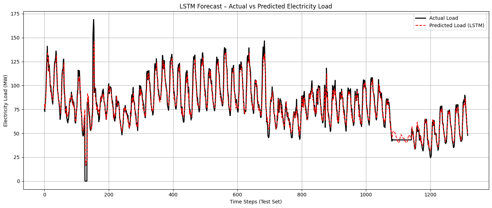</td>
<td>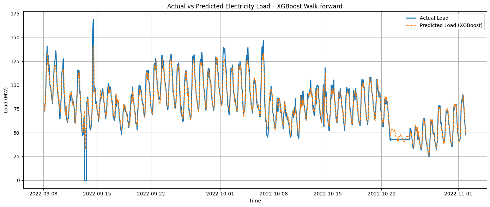</td>
</tr>
<tr>
<td align="center">LSTM – Actual vs Predicted (walk-forward)</td>
<td align="center">XGBoost – Actual vs Predicted (walk-forward)</td>
</tr>
<tr>
<td>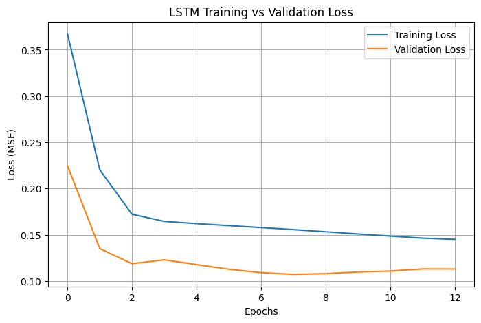</td>
<td>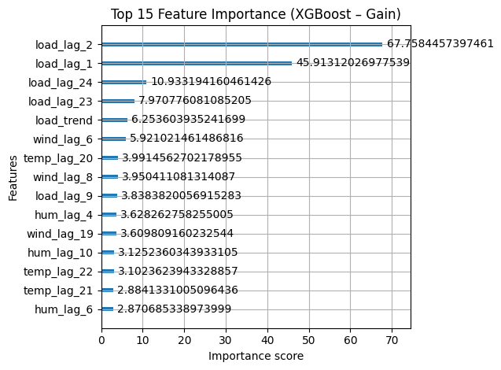</td>
</tr>
<tr>
<td align="center">LSTM – Training vs Validation loss</td>
<td align="center">XGBoost – Top 15 feature importance (gain)</td>
</tr>
</table>

### Nhận xét chính

- **Ba mô hình chênh nhau rất ít** (RMSE 7.30 – 7.46 MW). LSTM có RMSE thấp nhất, XGBoost có MAE và MAPE thấp nhất. Với dự báo 1 giờ tới, lịch sử tải gần nhất chứa phần lớn thông tin, nên baseline tuyến tính VAR đã rất cạnh tranh.
- **XGBoost dựa chủ yếu vào `load_lag_1`, `load_lag_2`** và nhóm lag 23–24 giờ (chu kỳ ngày). Các biến thời tiết chỉ đóng góp nhỏ khi đã có lịch sử load.
- Cả ba mô hình bắt tốt chu kỳ ngày. Sai số tập trung ở các **spike đột ngột** (ví dụ các giờ load rơi về 0 MW) – những sự kiện hiếm, không lặp lại trong dữ liệu huấn luyện.
- **LSTM** hội tụ nhanh: validation loss nhỏ nhất tại epoch 7, EarlyStopping dừng ở epoch 13 và khôi phục trọng số tốt nhất. Kết quả được cố định bằng `set_random_seed(42)`.
- **MAPE cần dùng cẩn thận:** dữ liệu có giờ load bằng 0 MW (chia cho 0) và nhiều giờ load rất nhỏ, khiến MAPE bị khuếch đại. Vì vậy RMSE và MAE là thước đo chính khi so sánh.

### Bài học từ quá trình sửa lỗi

| Lỗi | Hậu quả | Cách sửa |
|---|---|---|
| Inverse scaling LSTM lấy nhầm cột `YEAR` | RMSE báo 0.13, MAPE 0.004% – vô nghĩa | Lấy đúng chỉ số cột `load_MW` |
| Rolling feature XGBoost chứa `load_t` | Mô hình học quan hệ rò rỉ, không khớp lúc dự báo | Tính trên `load.shift(1)` → RMSE 7.57 → 7.37 |
| VAR đảo sai phân từ mốc cuối tập train | Đường "Actual" bị dời xuống ~27 MW, MAPE sai | Lấy mốc cuối tập validation, history gồm train + val |

---

## Cài đặt & chạy

```bash
git clone https://github.com/HoangPhucTony/Mis_TimeSeries_Lesson.git
```

```bash
pip install pandas numpy matplotlib seaborn scipy statsmodels scikit-learn xgboost tensorflow
```

```bash
python "Statistical_model(C3_P1)/SARIMA/SARIMA_MODEL.py"
```

> **Lưu ý:** Các script đang dùng **đường dẫn tuyệt đối** (`C:\DOHOANGPHUC\...`). Khi chạy trên máy khác, sửa biến `path`, `LOG_DIR`, `PLOT_DIR`, `BASE_DIR`, `data_path` ở đầu mỗi file cho phù hợp.
> Các script trong `Deep_Learning_model(C4_C5)/` import `utils.py`, nên cần chạy **từ bên trong thư mục đó**.

---

## Tác giả

**Đỗ Hoàng Phúc** – Sinh viên UTH
GitHub: [@HoangPhucTony](https://github.com/HoangPhucTony)

> Repo phục vụ mục đích học tập, lưu lại kiến thức đã học trong môn Phân tích Chuỗi Thời gian và Dự báo.
